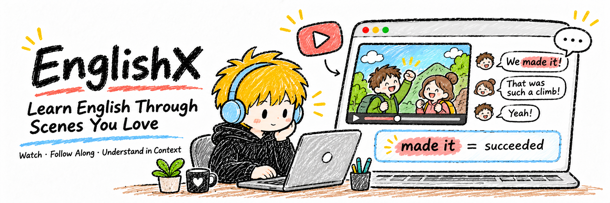

**English** | [简体中文](README.zh-CN.md)

<p align="center"></p>

# EnglishX

A native macOS client for learning English through film dialogue, sports commentary and talks you enjoy. Watch video on the left, follow dialogue on the right, and study only the current word below, in a quiet paper-and-crayon interface.

Source: [anjing-le/anjing-englishx](https://github.com/anjing-le/anjing-englishx). Open source under [MIT](LICENSE); see [NOTICE.md](NOTICE.md) for artwork and external dependencies.

**Local preview only — no official release or OTA updates yet.** The banner is an illustration, not a screenshot. Contextual meanings in the current app are primarily in Chinese; this English README does not imply a fully English-localized interface.

## Current features

- Local video playback, adjustable speed, sentence seeking and word-by-word highlighting; a collapsible clip library.
- Video and dialogue side by side, with word explanations below. Both splitters are draggable and remember their proportions.
- Drop a video, inspect its metadata, then explicitly start processing: local speech recognition, estimated word timings, model-assisted role suggestions and contextual explanations, saved to a local clip library.
- Dialogue in left/right bubbles, contextual meaning for the current word, and optional part-of-speech, lemma and phrase details.
- Correct transcripts, split or merge lines, confirm roles and edit word timings. Save a new version and regenerate explanations while preserving originals and previous results.
- Hover over the processing-principles badge in settings to inspect actual steps, current rule versions and complete prompts.
- Two original mock dialogues are included. Real videos, film transcripts and personal learning libraries are not distributed.

A learning item preserves a complete scene, not an enforced 30-second excerpt. Long material remains subject to local performance and per-task model timeouts; arbitrary-length videos are not guaranteed to finish automatically.

## Run locally

Requires macOS 14+, Xcode Command Line Tools and a Swift toolchain supporting Swift tools 5.10.

```sh
git clone https://github.com/anjing-le/anjing-englishx.git
cd anjing-englishx
bash scripts/preview.sh
```

The script builds an ad-hoc-signed local preview at `dist/preview/EnglishX.app`, then opens it. No Apple developer certificate is required. This is not a notarized installer and has no OTA or official release.

Processing real videos also requires executable `python3`, `ffmpeg`, `ffprobe`, `whisper-cli` (whisper.cpp), and an authenticated Codex CLI. First processing downloads approximately 148 MB of `base.en` speech weights and verifies a pinned SHA256. Trying the included mocks does not require model processing.

Explanations and frame analysis currently request `gpt-6.1-sol` with default reasoning effort `low`. Your Codex model catalog must offer it. Availability and quota depend on your account and environment; this repository supplies no account or API credentials and cannot guarantee model access everywhere.

Public source excludes personal icons and third-party cursor bitmaps, falling back to system icons/native cursors when absent. Locally, you may supply your own authorized `Resources/AppIcon.icns`. Do not upload a local preview package containing private artwork or media as a public release.

## Usage

| Action | Shortcut |
| --- | --- |
| Play / pause | Space |
| Seek backward / forward by the configured step | ← / → |
| Settings | ⌘, |
| Close the window while keeping the app running | ⌘W |
| Minimize | ⌘M |
| Full screen | ⌃⌘F |
| Quit | ⌘Q |

Open settings, choose or drop a local video, optionally enter its work/title, then explicitly start processing. View results or open review from settings. Opening settings, inspecting processing principles and playing existing clips do not automatically trigger model generation.

## Data and accuracy

- Original audio, full videos and the learning library stay on your Mac. Speech recognition and DTW alignment run locally. Role analysis sends sampled frames, transcript text and the optional work hint to Codex; word explanations send text only.
- An independent local Codex app-server reuses CLI login without reading or copying authentication files or changing global Codex configuration.
- Real material defaults to `~/Library/Application Support/EnglishX/Library`; weights live in the adjacent `Models` directory. Neither is stored in the repository.
- Automatic results remain marked as needing review. Word boundaries are attention-DTW estimates, not guaranteed phoneme-level alignment. Names, rapid commentary, overlapping speech and background music particularly require checking.
- Role suggestions currently concern fictional screen characters, not real actors. Audio speaker diarization and voice matching are not implemented. Sports commentary is not assigned fictional character identities.
- Processing currently generates a clip's word explanations in one job; it does not wait for a word click to generate detailed explanations.

Import only material you have permission to use. Open-source code does not grant reuse rights to external films, sports footage or talks.

## Validation and documentation

```sh
swift test --disable-keychain
python3 scripts/test_ingest.py
```

The linked engineering documents currently remain primarily in Chinese.

- [Processing workflow and boundaries](docs/ingestion-plan.md)
- [Teaching data and prompts](docs/teaching-contract.md)
- [Character analysis](docs/character-analysis.md)
- [Review and version saving](docs/review-workflow.md)
- [First real-sample validation](docs/real-sample-validation.md)
- [Classic-dialogue sample validation](docs/classic-dialogue-validation.md)

Validation records concern specific samples and versions, not equivalent quality for every input.
