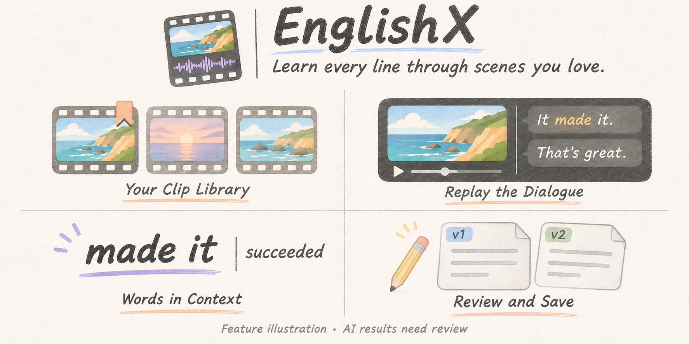
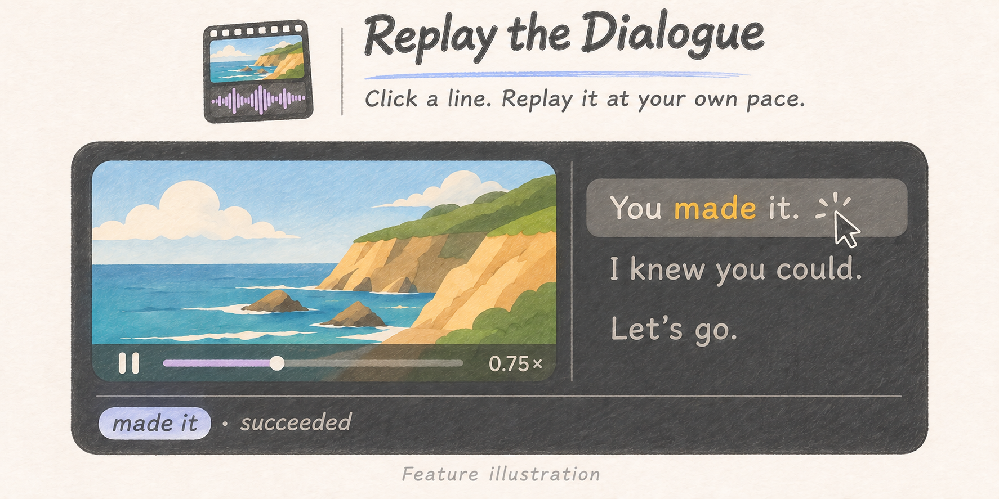
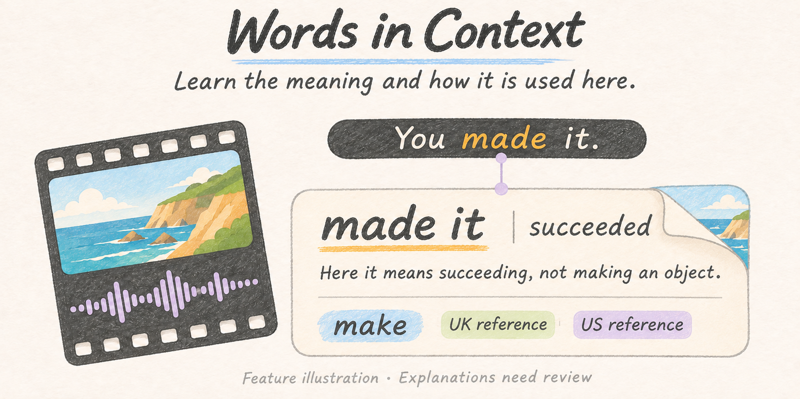
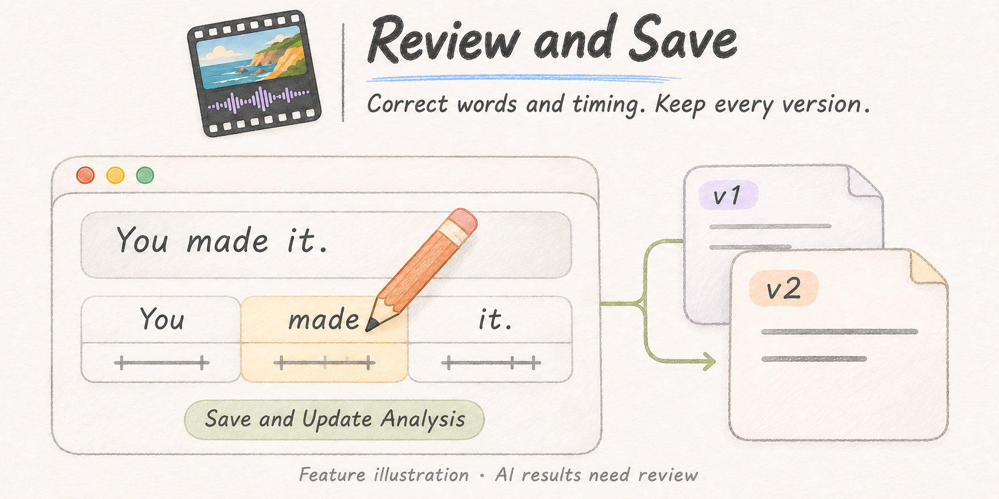
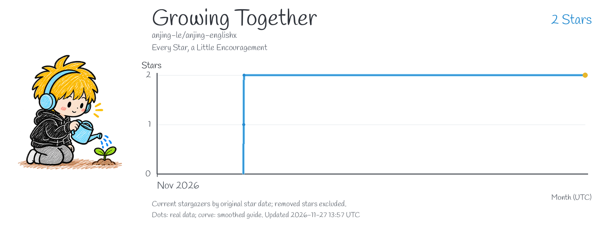

**English** · [简体中文](README.zh-CN.md) · [Get started](GUIDE.md#run-locally) · [Guide](GUIDE.md) · [MIT](LICENSE)

# EnglishX

  

  

  

  

  

  

These are feature illustrations, not product screenshots.

A native macOS client for learning English from videos you enjoy. Collect a scene, replay it, speak along and understand each word in context.

EnglishX owns the media, learning interface and local library. Language-understanding tasks are delegated to an agent:

- **Local processing** extracts audio, transcribes speech and estimates word timing. The language model does not invent timestamps.
- **Agent analysis** currently uses the local Codex CLI app-server with `gpt-6.1-sol` and existing CLI authentication to produce contextual explanations and fictional screen-character suggestions.
- **Validation and learning** checks structured results before saving them locally. Playback, word following and viewing saved explanations do not invoke the agent again.

Only Codex integration is implemented today. A pluggable agent interface is being designed; compatibility with other agents or models is not yet established. Recognition runs locally; Codex receives transcript text and, for fictional-role analysis, sampled frames. Automatic results need review.

macOS 14+ · Local preview · [Setup and usage](GUIDE.md) · [Data and accuracy](GUIDE.md#data-and-accuracy)

