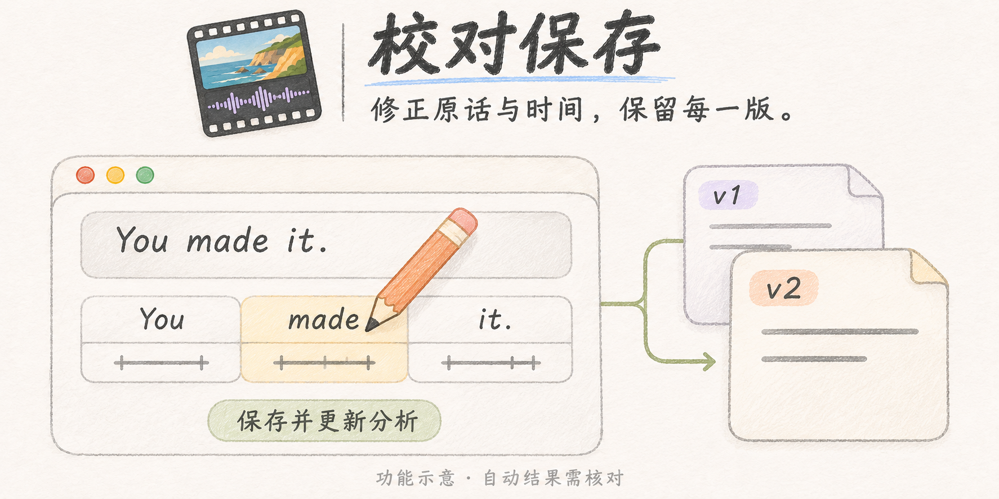
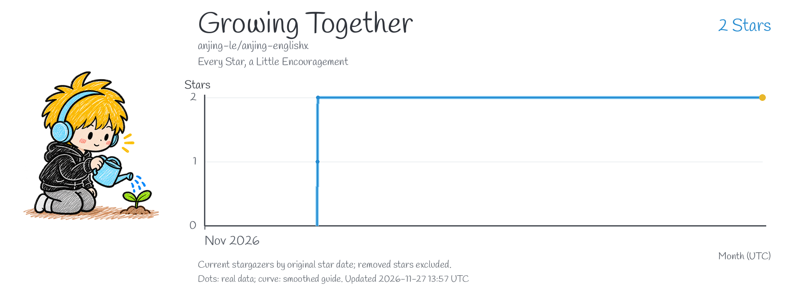

[English](README.md) · **简体中文** · [开始使用](GUIDE.zh-CN.md#本地运行) · [使用指南](GUIDE.zh-CN.md) · [MIT](LICENSE)

# EnglishX

  

  

  

  

  

  

以上为功能示意插画，不是真实产品截图。

一个原生 macOS 视频英语学习客户端：收藏喜欢的桥段，反复听、跟着说，理解每个词在这句话里的意思。

EnglishX 管理视频、学习界面和本地数据，把需要语言理解的加工步骤交给 agent：

- **本地处理**：提取音频、听写和估计逐词时间，不让语言模型猜时间戳。
- **Agent 分析**：目前通过本机 Codex CLI 的 app-server 接入 `gpt-6.1-sol`，复用已有登录，生成语境讲解与虚构影视角色建议。
- **校验与学习**：检查结构化结果后保存到本地片段库；播放、逐词跟随、回放和已有讲解的查看不再调用 agent。

目前仅实现 Codex 接入。可插拔的 agent 接口正在设计，尚不代表已经兼容其他 agent 或模型。语音识别在本地；分析会向 Codex 发送对白文字，影视角色任务还会发送抽样画面。自动结果需要校对。

macOS 14+ · 本地预览 · [安装与使用](GUIDE.zh-CN.md) · [数据与准确性](GUIDE.zh-CN.md#数据与准确性)

